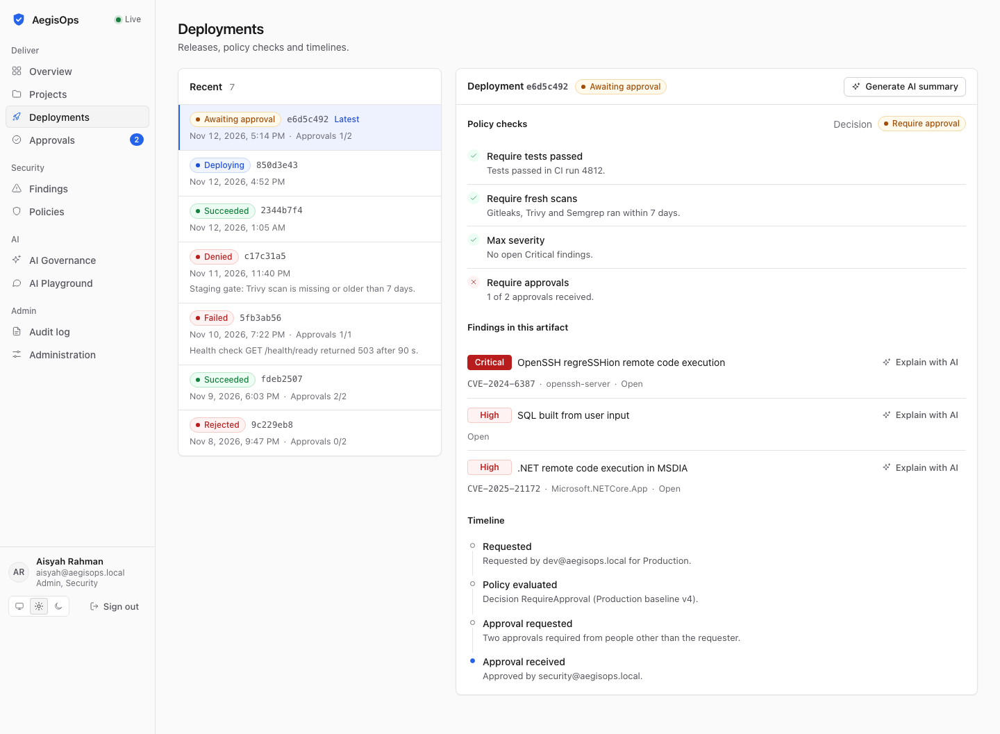
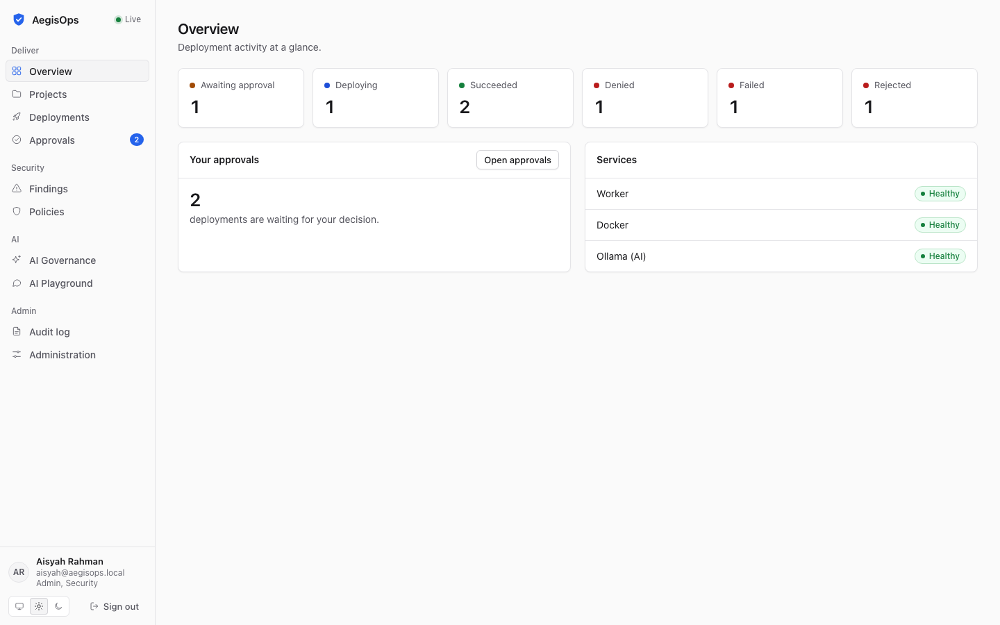
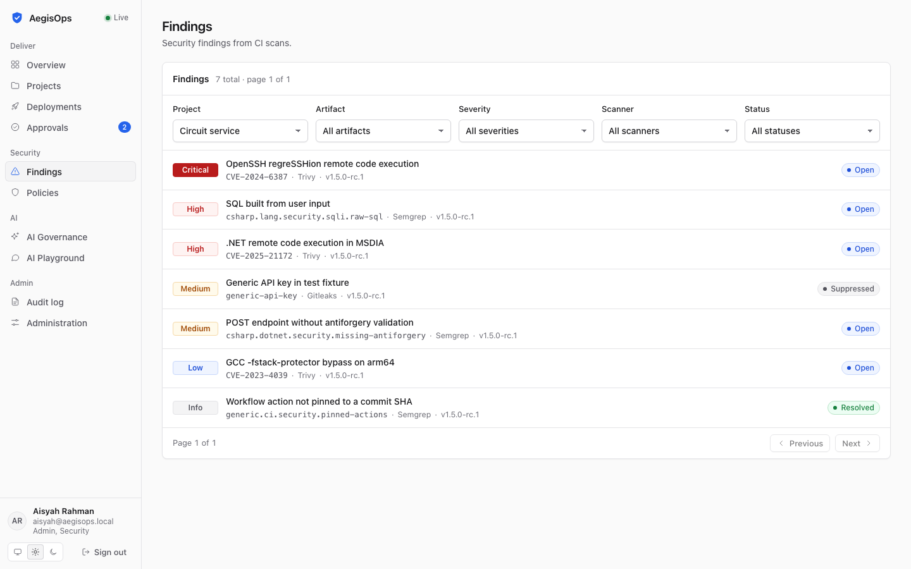
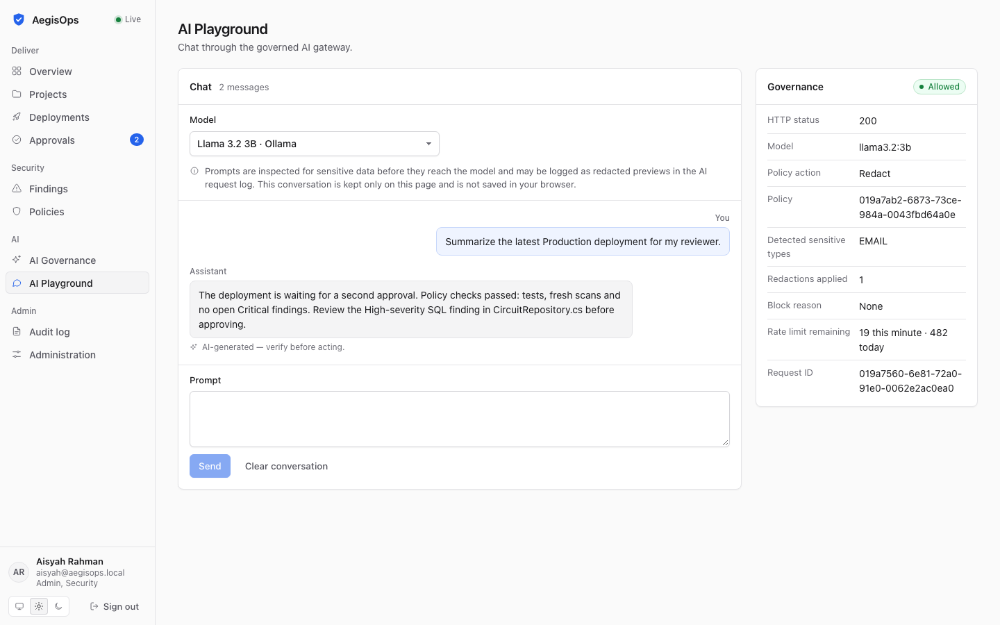

# AegisOps

**A self-hosted control plane between your CI and your environments.** AegisOps decides whether a build may
reach an environment, runs the deployment, and governs how people use AI models, with an audit trail for both.

[](https://github.com/Trixxy98/AegisOps---DevSecOps-AI-Control-Plane/actions/workflows/ci.yml)
[](https://github.com/Trixxy98/AegisOps---DevSecOps-AI-Control-Plane/releases)
[](LICENSE)

<picture>
  <source media="(prefers-color-scheme: dark)" srcset="docs/assets/screens/dark-deployments.png">
  
</picture>

## What it does

- **Registers CI builds and their security evidence.** GitHub Actions uploads the artifact and Gitleaks,
  Semgrep and Trivy results (SARIF); findings are normalised and tracked.
- **Gates every deployment with policies.** Each request is evaluated to *Allow*, *Require approval* or *Deny*,
  with a rule-by-rule explanation. Production can require two approvals from people other than the requester.
- **Deploys and rolls back Docker containers** through a Worker with leased jobs, health checks and encrypted
  per-environment secrets. Timelines and approval requests update live.
- **Governs AI use.** A gateway in front of a local LLM (Ollama) applies model allow-lists, sensitive-data
  redaction or blocking, and per-user rate limits.
- **Audits everything.** Every state change is recorded; in production the application cannot modify or
  delete audit rows.

|  |  |  |
| --- | --- | --- |
| <picture><source media="(prefers-color-scheme: dark)" srcset="docs/assets/screens/dark-overview.png"></picture> | <picture><source media="(prefers-color-scheme: dark)" srcset="docs/assets/screens/dark-findings.png"></picture> | <picture><source media="(prefers-color-scheme: dark)" srcset="docs/assets/screens/dark-ai-playground.png"></picture> |
| Overview | Findings | AI Playground |

## Quick start

Try it on your own machine (Docker Compose, ~4 GB free memory):

```bash
scripts/gen-secrets.sh                                # creates a private .env with random keys
docker compose up --build -d                          # web http://127.0.0.1:3000
docker compose logs api | grep 'Development user'     # first-run demo passwords, shown once
```

Sign in as `admin@aegisops.local` and choose a new password. The demo data includes users for each role, a
team, three projects and policies. Details, the optional local AI model and monitoring:
[local development](docs/local-development.md).

**Running it for a team?** Use the published images on one server with HTTPS:
[deploy to production](docs/deploy-production.md).

## Documentation

| Start here | |
| --- | --- |
| [User manual](docs/user-manual.md) | Concepts in plain words, installation and hands-on tutorials |
| [Connect your repository](docs/connect-your-repository.md) | Onboard your own app with GitHub Actions |
| [Deploy to production](docs/deploy-production.md) | One server, HTTPS, first admin, upgrades |
| [Operations guide](docs/operations.md) | Backups and restore, key rotation, monitoring, sizing |
| [Design documents](docs/README.md) | Architecture, policy engine, AI gateway, API, security model and ADRs |

## Tech stack

ASP.NET Core 10 (API and Worker), EF Core with PostgreSQL, Redis, SignalR, React 19 with TypeScript and
Tailwind CSS, Docker Compose, GitHub Actions, Ollama, OpenTelemetry with Prometheus and Grafana.

Each release publishes multi-arch images (amd64 and arm64) to GHCR after a Trivy gate; CI runs over a thousand
tests plus Semgrep, Gitleaks, and npm and NuGet vulnerability checks.

## Limits

AegisOps runs on **one server for one organisation**: no high availability, single sign-on or MFA yet, and it
deploys to Docker on the same host. The Worker uses the Docker socket, so give AegisOps a dedicated host.
See [deploy-production](docs/deploy-production.md#11-what-is-not-covered-yet) and the
[security model](docs/17-security-hardening.md).

## Design notes

- **PostgreSQL as the job queue.** Jobs are leased with `FOR UPDATE SKIP LOCKED`, so a timeline event and its
  follow-up job commit together without a message broker.
- **The policy engine is a pure function.** No I/O, so every decision is explainable, can be simulated before
  saving, and is re-checked just before execution.
- **Real-time with a fallback.** SignalR pushes updates; polling takes over only while disconnected, so
  correctness never depends on a message arriving.
- **Bounded telemetry.** Metric labels are fixed sets: no user IDs, prompts or image names.

## Contributing and security

See [CONTRIBUTING.md](CONTRIBUTING.md). Report vulnerabilities privately as described in
[SECURITY.md](SECURITY.md). Released under the [MIT License](LICENSE).
