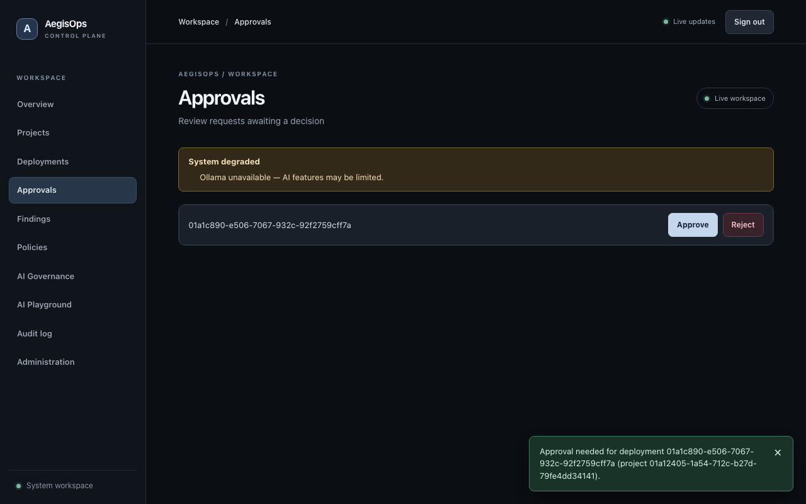
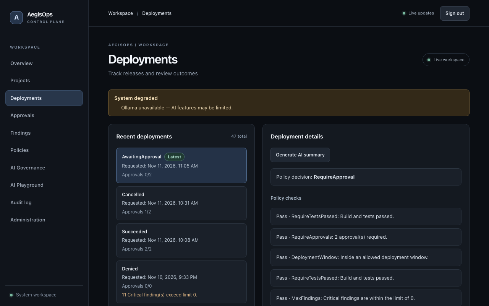

# AegisOps — DevSecOps & AI Control Plane

> **Status:** v1 release candidate. All four v1 journeys run end to end on the local Compose stack:
> CI-registered artifacts with Gitleaks/Semgrep/Trivy evidence, policy-gated Docker deployments with
> two-person Production approvals, live updates over SignalR, and a governed local LLM gateway. Progress
> against the roadmap is tracked in [`docs/v1-progress-audit.md`](docs/v1-progress-audit.md); the design is in
> [`docs/README.md`](docs/README.md).

AegisOps is a self-hosted **control plane** that sits between CI and your environments.
It does not build code (GitHub Actions does that). It decides **whether a change may
reach an environment**, and it governs **how people and services use AI models** — with a
complete audit trail for both.

```
                GitHub Actions (CI)                         Users
        build · test · gitleaks · trivy · semgrep             │
                        │                                     │
                        ▼                                     ▼
┌──────────────────────────────────────────────────────────────────────┐
│                              AegisOps                                │
│                                                                      │
│   Artifacts ─► Security Scans ─► Policy Engine ─► Approvals ─► Deploy │
│                                                                      │
│   AI Gateway: model access · rate limit · sensitive-data · audit     │
└──────────────────────────────────────────────────────────────────────┘
                        │                                     │
                        ▼                                     ▼
          Target services (staging / production)        Ollama (local LLM)
```

## Demo


*Recorded from the real Compose stack by the opt-in live test (`npm run test:e2e:live`): a developer (left)
requests a Production deployment, the Worker evaluates it to **RequireApproval (2)**, the security approver
(right) receives the toast within a second and approves, and the developer's list updates without a reload.
The test then cancels the request.*

| Approval toast | Policy explanation | One of two approvals |
| --- | --- | --- |
|  |  |  |

To re-record: `AEGISOPS_LIVE_VIDEO=1 npm run test:e2e:live` in `src/AegisOps.Web` (demo passwords in the
environment), then `scripts/make-demo-gif.sh`.

## What AegisOps governs

| Plane | Question it answers | Result |
| --- | --- | --- |
| **Deployment governance** | "May artifact `v1.8.2` of `circuit-service` reach **Production**?" | `ALLOW` / `REQUIRE_APPROVAL` / `DENY` with a rule-by-rule explanation |
| **AI governance** | "May this user send this prompt to this model right now?" | Forwarded, redacted, or blocked — always audited |

## Target applications

AegisOps manages a small fleet of independent demo services (each in its own repository
with its own CI pipeline). They exist to be built, scanned, evaluated and deployed:

| Service | Purpose |
| --- | --- |
| `site-service` | Network site & device inventory |
| `circuit-service` | Circuit / link management |
| `notification-service` | Outbound notifications (email/webhook stubs) |

See [`docs/13-target-applications.md`](docs/13-target-applications.md).

## Locked tech stack (v1)

| Area | Choice |
| --- | --- |
| Frontend | React · TypeScript · Tailwind CSS · TanStack Query · Axios · SignalR client |
| Backend | C# · ASP.NET Core 10 · EF Core · ASP.NET Core Identity · JWT · SignalR |
| Architecture | Clean Architecture · Modular Monolith · separate Worker process |
| Data | PostgreSQL (source of truth) · Redis (ephemeral / high-frequency state) |
| DevOps | Docker · Docker Compose · GitHub Actions |
| Security scanners | Gitleaks · Trivy · Semgrep |
| AI | Ollama (local LLM) |
| Observability | OpenTelemetry · Prometheus · Grafana |
| Testing | xUnit · Testcontainers · integration tests · Vitest |

Deliberately **out of scope for v1**: Kubernetes, Kafka/RabbitMQ, Terraform, cloud
providers, LangChain, multiple AI providers. See [`docs/03-tech-stack.md`](docs/03-tech-stack.md).

## Documentation map

| # | Document | What it covers |
| --- | --- | --- |
| 01 | [Vision & scope](docs/01-vision-and-scope.md) | Problem, goals, non-goals, personas, success criteria |
| 02 | [Architecture](docs/02-architecture.md) | Context/container diagrams, modules, layering, key flows |
| 03 | [Tech stack](docs/03-tech-stack.md) | Every technology, why it was chosen, what is excluded |
| 04 | [Domain model](docs/04-domain-model.md) | Entities, enums, relationships, state machines |
| 05 | [Policy engine](docs/05-policy-engine.md) | Rule types, evaluation algorithm, explainability |
| 06 | [Deployment pipeline](docs/06-deployment-pipeline.md) | End-to-end lifecycle, worker jobs, executors |
| 07 | [Security scanning](docs/07-security-scanning.md) | Gitleaks/Trivy/Semgrep, SARIF normalization, severities |
| 08 | [AI gateway](docs/08-ai-gateway.md) | Governance pipeline, rate limits, sensitive-data detection |
| 09 | [Identity & authorization](docs/09-identity-and-authorization.md) | Roles, permissions, policy-based authorization, API keys |
| 10 | [API specification](docs/10-api-specification.md) | REST endpoints, conventions, SignalR hub contract |
| 11 | [Database design](docs/11-database-design.md) | Schemas, tables, indexes, migrations, seeding |
| 12 | [Frontend](docs/12-frontend.md) | Pages, routing, data layer, realtime, structure |
| 13 | [Target applications](docs/13-target-applications.md) | The demo services AegisOps governs |
| 14 | [DevOps & infrastructure](docs/14-devops-and-infrastructure.md) | Docker Compose, Dockerfiles, GitHub Actions workflows |
| 15 | [Observability](docs/15-observability.md) | Metrics, traces, logs, dashboards, health checks |
| 16 | [Testing strategy](docs/16-testing-strategy.md) | Test pyramid, PolicyEngine test matrix, integration tests |
| 17 | [Security hardening](docs/17-security-hardening.md) | Threat model and controls for AegisOps itself |
| 18 | [Repository structure & conventions](docs/18-repository-structure-and-conventions.md) | Solution layout, coding standards, Git workflow |
| 19 | [Roadmap](docs/19-roadmap.md) | Phases 0–8, deliverables, definition of done |
| 20 | [Glossary](docs/20-glossary.md) | Terminology |
| — | [ADRs](docs/adr/README.md) | Architecture decision records |

## Local quick start (Development only)

Requires Docker Compose. The API migrates the local database on startup and seeds demo
users, a team, and policies. Use a fresh random JWT signing key (32+ bytes); never use
the `.env.example` value outside local development.

```bash
scripts/gen-secrets.sh   # writes a mode-600 .env with random keys (or: cp .env.example .env and edit JWT_SIGNING_KEY)
docker compose up --build -d
docker compose logs api | grep 'Development user admin@aegisops.local created'
# Copy the printed password (only generated on first startup) and open http://localhost:3000
AEGISOPS_ADMIN_PASSWORD='<password from logs>' scripts/smoke-compose-deployment.sh
```

The smoke test uses the Web proxy to sign in, create a project/artifact, request a
Development deployment, and assert the worker recorded an Allow evaluation and
Succeeded event and updated the environment's current artifact. Each run creates a
uniquely named test project in the local database. If the database already exists, the
seed password is not regenerated: keep the first-run password or reset the local database deliberately.
The API is also exposed at `http://localhost:8080`; Web is at `http://localhost:3000`.

### Optional Prometheus and Grafana

Set `GRAFANA_ADMIN_PASSWORD` in your shell or the gitignored `.env` file before
starting the opt-in overlay; there is no checked-in/default Grafana password.
The base Compose stack does not require this variable. With a working Docker daemon:

```bash
docker compose -f docker-compose.yml -f deploy/docker-compose.observability.yml \
  --profile observability up --build -d
```

Open Grafana at `http://127.0.0.1:3001` (user `admin`, password from your
configuration) and the Prometheus targets/rules pages at `http://127.0.0.1:9090`.
Only these UI ports bind to host loopback; Prometheus scrapes API `:9464` and
Worker `:8081` internally. The provisioned **AegisOps Overview** dashboard
shows API p95/5xx and Worker queue/throughput; additional Delivery/AI panels
need instruments that are not yet built. Prometheus rules do not send notifications
by default. To stop only monitoring, use the same Compose flags followed by
`stop grafana prometheus`; do not run `down -v` because it removes persistent data.
See [`docs/15-observability.md`](docs/15-observability.md) for metric semantics.

This path uses the **noop** executor; it does not start a target container. For the
existing `site-service` project only, the Development seed changes its **Staging**
environment from noop to Docker (`site-service-staging`, network `aegisops-staging`,
host port 8101, container port 8080, `/health`). It never changes Production or an
operator-configured target. Staging requires three fresh security scans and passing
tests. Register a real CI artifact from `ghcr.io/trixxy98/site-service` before
requesting Staging; `ghcr.io/aegisops/site-service:latest` in the design-only
`deploy/docker-compose.targets.yml` is not a published image. That file is **not**
part of this Compose startup; do not start its Production services. The target image
currently publishes linux/amd64 only; the executor retries with that platform when
the default pull fails on arm64.

The Worker passes the target environment name to new containers as both
`DOTNET_ENVIRONMENT` and `ASPNETCORE_ENVIRONMENT`. `site-service` reads this via
ASP.NET for `/version`; an already-running Staging container will continue to say
Production until a new authorized Staging deployment replaces it. This does not
modify running containers or the Production target.

Compose mounts the host Docker socket **only into the Worker** so it can manage
containers. `DOCKER_HEALTH_HOST=host.docker.internal` lets the Worker probe host
published port 8101 (its own loopback is not the Docker host). This assumes Docker
Desktop; another Docker host needs an operator-configured reachable address. The
API does not have socket access. Its Docker runtime endpoint reports
`inspectionAvailable: false` and `containers: null` when no Docker socket exists,
rather than returning 503 or pretending that no containers are running. The
deployment timeline and host `/health` and `/version` remain usable. Other Docker
errors can still return 503; no socket access is added to the API.
The Docker socket grants effective root-equivalent control over the host Docker daemon
and all containers/volumes, despite being mounted only in the Worker. Run this
Development stack only on a trusted local machine, restrict access to AegisOps
deployment APIs, and never use this pattern in Production without isolating the daemon
or introducing a constrained Docker authorization proxy. The executor refuses to
replace an unlabeled/foreign named container or remove an existing `-previous` backup;
verify target names and port 8101 are free before requesting a deployment. It does not
auto-deploy during Compose startup. Check wiring with
`python3 tests/staging-docker-contract.py`. Do not point this stack at production.
For the controlled upgrade and failed-health rollback exercise, see
[`docs/staging-rollback-validation.md`](docs/staging-rollback-validation.md).

SARIF uploads larger than 2 MB are queued for parsing by the worker. Compose mounts a
dedicated persistent `reports` volume at `/app/reports` in both API and worker, separate
from `pgdata`. Before upgrading an existing stack, preserve any pending reports from the
old API container's `/app/reports` (or re-upload those reports after upgrading); an
existing container's private filesystem is **not** migrated automatically into the new
volume. Do not run `docker compose down -v`: it deletes the database and reports volumes.
Check the mount wiring with `python3 tests/report-storage-contract.py`.

### Optional local AI model (Ollama) and hardware

The AI gateway talks to Ollama at `http://ollama:11434/`. Ollama is opt-in:

```bash
docker compose --profile ai up -d   # starts ollama, then ollama-init pulls the model once
OLLAMA_MODEL=qwen2.5-coder:7b docker compose --profile ai up -d ollama-init   # optional second model
```

| Model | Download | Practical minimum | Notes |
| --- | --- | --- | --- |
| `llama3.2:3b` (default) | ~2 GB | 8 GB RAM, 4 CPU cores, no GPU | Chat, deployment summaries; expect a few seconds per reply on CPU |
| `qwen2.5-coder:7b` (optional) | ~4.7 GB | 16 GB RAM; GPU or Apple Silicon recommended | Better finding explanations; slow on CPU-only laptops |

- Leave at least 4 GB free for PostgreSQL, Redis, the API/Worker and the browser on top
  of the model's memory. Models are kept in the `ollama` volume, so pulls happen once.
- Docker Desktop on macOS runs Ollama in a Linux VM **without** Metal GPU access, so it
  is CPU-only. For faster replies, run native Ollama on the host (optionally with
  `OLLAMA_MODELS` on an external disk) and add `-f deploy/docker-compose.host-ollama.yml`,
  which points the API at `http://host.docker.internal:11434/`. On an Apple M4, a
  `llama3.2:3b` reply took about 2 s this way.
- NVIDIA GPUs on Linux need the NVIDIA Container Toolkit and a `gpus: all` override for
  the `ollama` service.
- Without Ollama the platform still runs: readiness reports Ollama as Degraded, and AI
  requests fail with `ProviderUnavailable` (sensitive-data blocks still apply first).

## Releases

Pushing a version tag runs `.github/workflows/release.yml`: it builds the API, Worker and web images, refuses
to publish any image with a fixable CRITICAL vulnerability (Trivy), pushes them to
`ghcr.io/<owner>/aegisops-{api,worker,web}:<tag>` and `:latest`, and creates the GitHub Release.

```bash
git tag v1.0.0 && git push origin v1.0.0
```

## Interview notes — design trade-offs

- **PostgreSQL job queue instead of a broker.** Jobs are leased with
  `FOR UPDATE SKIP LOCKED`, heartbeats and lease tokens, so a single dependency gives
  transactional outbox semantics (a timeline event and its notification job commit
  together). The cost is polling and a write-heavy table, which retention cleanup bounds.
- **Policy engine as a pure function.** `PolicyEngine.Evaluate(context, policies)` has no
  I/O, so every decision is explainable rule-by-rule, simulated before saving, and
  re-checked just before execution (approvals can go stale).
- **Docker socket on a single trusted host.** Mounting the socket is root-equivalent; v1
  accepts that for a single-host demo, adds ownership labels so the Worker only replaces
  its own containers, and documents a docker-socket-proxy alternative (docs/14).
- **Local LLM behind a gateway.** Ollama keeps prompts on the machine; the gateway
  enforces per-team model allow-lists, rate limits and sensitive-data redaction/blocking
  before any provider call, and stores previews rather than content by default.
- **Real-time with a fallback.** SignalR pushes timelines and approval toasts, Redis
  carries Worker hints to API instances, and polling remains as a fallback; correctness
  never depends on a message being delivered.
- **Bounded telemetry.** Metric labels and span attributes are fixed enums (no user ids,
  prompts, image names or exception messages); zero-valued series are seeded so the first
  event is visible to `rate()`.
- **Evidence-based progress.** `docs/v1-progress-audit.md` counts only verified checks,
  so the score is a floor rather than a claim.

## License

MIT (to be added with the first code commit).
