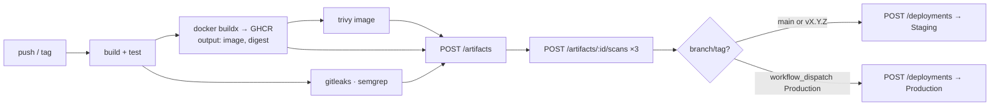

# 14 — DevOps & Infrastructure

## 1. Local / demo topology (Docker Compose)

```
docker compose up -d                      # core: postgres, redis, migrate, api, worker, web
docker compose --profile ai up -d         # + ollama, ollama-init
docker compose --profile observability up -d   # + prometheus, grafana
docker compose -f deploy/docker-compose.targets.yml up -d   # target networks + latest target images

# Production profile on one server (docs/deploy-production.md)
P="-f docker-compose.yml -f deploy/docker-compose.prod.yml -f deploy/docker-compose.tls.yml"
docker compose $P run --rm migrate                                   # migrations + roles, then exit
docker compose $P run --rm api bootstrap-admin --email you@example.com
docker compose $P up -d                                              # caddy on 80/443, nothing else published
```

### `docker-compose.yml` (services)

| Service | Image | Ports | Depends on | Notes |
| --- | --- | --- | --- | --- |
| `postgres` | `postgres:17-alpine` | 5432 (dev only) | — | volume `pgdata`; `POSTGRES_DB=aegisops`; healthcheck `pg_isready` |
| `redis` | `redis:7-alpine` | 127.0.0.1:6380 → 6379 (dev only; `AEGISOPS_REDIS_PORT`) | — | `--maxmemory 256mb --maxmemory-policy allkeys-lru`; no persistence needed |
| `migrate` | `aegisops-api` | — | postgres healthy | `deploy/docker-compose.prod.yml` only, profile `tools`: `dotnet AegisOps.Api.dll migrate` (EF migrations + the four roles, idempotent); `restart: "no"`. In Development the API migrates and seeds at startup instead (`Database__MigrateOnStartup=true`) |
| `api` | `aegisops-api` (built from `src/AegisOps.Api/Dockerfile`) | 127.0.0.1:8080 (none with the TLS override) | postgres, redis | env: connection strings, JWT signing key, Ollama URL; volume `reports`. Commands: `migrate`, `bootstrap-admin --email … [--display-name …]` |
| `worker` | `aegisops-worker` | 8081 internal (health/metrics) | api | mounts `/var/run/docker.sock` (group `DOCKER_GID`); volume `reports` |
| `web` | `aegisops-web` (nginx) | **3000** | api | serves SPA, proxies `/api`, `/hubs` |
| `ollama` | `ollama/ollama` | 11434 internal | — | profile `ai`; volume `ollama`; GPU passthrough optional |
| `ollama-init` | `ollama/ollama` | — | ollama | profile `ai`; `ollama pull llama3.2:3b` then exits |
| `prometheus` | `prom/prometheus` | 9090 | api, worker | profile `observability`; config `deploy/prometheus/prometheus.yml` |
| `grafana` | `grafana/grafana` | **3001** | prometheus | profile `observability`; provisioned datasource + dashboards from `deploy/grafana/` |
| `caddy` | `caddy:2.10.2-alpine` | **80, 443** (public) | web | `deploy/docker-compose.tls.yml` only: TLS for `AEGISOPS_DOMAIN` (ACME, `ACME_EMAIL`), HTTP→HTTPS, HSTS, proxies to `web`; `deploy/caddy/Caddyfile`; web/api host ports removed |

Overrides: `deploy/docker-compose.prod.yml` sets `ASPNETCORE_ENVIRONMENT`/`DOTNET_ENVIRONMENT=Production` for api
and worker, `Database__MigrateOnStartup=false`, requires `POSTGRES_PASSWORD` and `APP_DB_PASSWORD` (api/worker connect as
`aegisops_app`, only `migrate` as the owner), removes the Postgres/Redis host ports,
adds `restart: unless-stopped` and the `migrate` service. `deploy/docker-compose.tls.yml` adds Caddy and the API's
forwarded-headers settings.

Networks: `aegisops` (platform). Target networks `aegisops-staging`, `aegisops-production`
are created by the targets compose file (external) so the Worker can attach containers.

`docker-compose.override.yml` (dev): exposes Postgres/Redis ports, mounts source for the
web dev server (`vite` with HMR on 5173 proxying to `api`), enables Scalar anonymously.

### Environment variables (api / worker)

| Variable | Example | Notes |
| --- | --- | --- |
| `ConnectionStrings__Postgres` | `Host=postgres;Database=aegisops;Username=aegisops_app;Password=…` | Production profile: api/worker connect as the restricted role `aegisops_app` (`APP_DB_PASSWORD`; `SELECT`/`INSERT` only on `audit.*`), the `migrate` service as the owner `aegisops` (`POSTGRES_PASSWORD`). Development (root file): api/worker connect as the owner, as before |
| `AppDatabase__Password` | `${APP_DB_PASSWORD}` | `migrate` only: creates/updates `aegisops_app` with this password and applies its grants (idempotent; docs/17 §3). Unset: the role is left alone. `.env` key generated by `scripts/gen-secrets.sh` (`--upgrade` adds it to an existing file) |
| `RateLimits__Global__TokenLimit`, `…__TokensPerPeriod`, `…__ReplenishmentPeriodSeconds` | `300`, `50`, `10` | api; token bucket per user/API key (client IP when anonymous) on `/api/*`, a separate one on `/hubs/*`; health and metrics are not limited |
| `RateLimits__Uploads__TokenLimit`, `…__TokensPerPeriod`, `…__ReplenishmentPeriodSeconds` | `30`, `5`, `10` | api; scan uploads per principal, in addition to the global bucket |
| `RateLimits__Auth__PermitLimit`, `RateLimits__Auth__WindowSeconds` | `10`, `60` | api; login/refresh per client IP (fixed window). All 429s carry `Retry-After` |
| `ConnectionStrings__Redis` | `redis:6379` | |
| `Jwt__Issuer`, `Jwt__Audience`, `Jwt__SigningKey` | | ≥ 32 random bytes; generated by `scripts/gen-secrets.sh` into `.env` |
| `Jwt__AccessTokenMinutes`, `Jwt__RefreshTokenDays` | `15`, `7` | |
| `EnvironmentSecrets__Enabled`, `EnvironmentSecrets__CurrentKeyId`, `EnvironmentSecrets__Keys__<id>` | `true`, `key1`, base64 32 bytes (slots `key1`, `key2`; rotation in [operations.md §5.3](operations.md#53-environment-secret-encryption-keys-environment_secrets_)) | api + worker; encrypts secret environment variables (docs/17 §5); `.env` keys `ENVIRONMENT_SECRETS_*` generated by `scripts/gen-secrets.sh` |
| `AiContent__Enabled`, `AiContent__CurrentKeyId`, `AiContent__Keys__<id>` | `true`, `key1`, base64 32 bytes (slots `key1`, `key2`; rotation in [operations.md §5.6](operations.md#56-stored-ai-content-encryption-keys-ai_content_)) | api only; encrypts stored AI content when an AI policy has `StoreContent` (docs/08, docs/17 §5); without a key content is not stored; enabled without its current key, the API does not start; `.env` keys `AI_CONTENT_*` generated by `scripts/gen-secrets.sh` (`--upgrade` adds them) |
| `Ai__Ollama__BaseUrl` | `http://ollama:11434` | |
| `Storage__ReportsPath` | `/data/reports` | volume |
| `Worker__MaxConcurrency`, `Worker__RunScans` | `4`, `false` | |
| `Docker__Endpoint` | `unix:///var/run/docker.sock` | worker only |
| `Docker__Registries__0__Server`, `…Username`, `…Token` | GHCR creds | worker only |
| `Seed__Demo` | `true` | demo data |
| `OTEL_EXPORTER_OTLP_ENDPOINT` | optional | traces |
| `Cors__AllowedOrigins__0` | `http://localhost:5173` | dev only |
| `ASPNETCORE_ENVIRONMENT` / `DOTNET_ENVIRONMENT` | `Development` (Compose) / `Production` (prod override) | outside Development the API refuses to start with a missing JWT key, the `.env.example` placeholder key or the Development database password (`ProductionSafety`) |
| `Database__MigrateOnStartup` | `true` (Development) / `false` | refused outside Development; use the `migrate` command |
| `ForwardedHeaders__Enabled` | `false` | api; honour `X-Forwarded-For`/`-Proto` (docs/17). `true` in the TLS override |
| `ForwardedHeaders__KnownNetworks__<n>`, `ForwardedHeaders__KnownProxies__<n>` | `172.16.0.0/12` (`AEGISOPS_PROXY_NETWORK`) | api; required when enabled; only these (and loopback) are trusted |
| `ForwardedHeaders__ForwardLimit` | `1` (code default), `2` (TLS override: Caddy → nginx) | api; proxy hops to unwind |
| `AEGISOPS_DOMAIN`, `ACME_EMAIL` | `aegisops.example.com`, `ops@example.com` | `.env`, TLS override (Caddy) |

`.env.example` is committed; `.env` is git-ignored and scanned by Gitleaks anyway.

## 2. Dockerfiles

### API / Worker (multi-stage)

```dockerfile
FROM mcr.microsoft.com/dotnet/sdk:10.0 AS build
WORKDIR /src
COPY Directory.Build.props Directory.Packages.props AegisOps.slnx ./
COPY src/ src/
RUN dotnet restore src/AegisOps.Api/AegisOps.Api.csproj
RUN dotnet publish src/AegisOps.Api/AegisOps.Api.csproj -c Release -o /app --no-restore

FROM mcr.microsoft.com/dotnet/aspnet:10.0-alpine AS runtime
WORKDIR /app
RUN adduser -D -u 10001 aegisops
COPY --from=build /app .
USER aegisops
EXPOSE 8080
HEALTHCHECK CMD wget -qO- http://localhost:8080/health/live || exit 1
ENTRYPOINT ["dotnet", "AegisOps.Api.dll"]
```

Worker identical with its project; Worker runtime image additionally needs the Docker
socket group id matched (`--group-add` via compose `group_add`).

On a Mac host the socket is `unix://${HOME}/.docker/run/docker.sock`, not
`/var/run/docker.sock`. Set `DOCKER_HOST` (or `Docker:Endpoint`) to that path.
Mounting the raw socket into the Worker is equivalent to root on the host. Prefer a
[docker-socket-proxy](https://github.com/Tecnativa/docker-socket-proxy) sidecar that
allows only `CONTAINERS=1`, `IMAGES=1`, `NETWORKS=1`, and keep `POST=1` for create/start.
Point `DOCKER_HOST` at `tcp://docker-socket-proxy:2375` and do not mount the socket
into the Worker.

### Web

```dockerfile
FROM node:22-alpine AS build
WORKDIR /web
COPY src/AegisOps.Web/package*.json ./
RUN npm ci
COPY src/AegisOps.Web/ .
RUN npm run build

FROM nginx:1.27-alpine
COPY deploy/web/nginx.conf /etc/nginx/conf.d/default.conf
COPY --from=build /web/dist /usr/share/nginx/html
EXPOSE 80
```

Images are scanned by Trivy in CI; base tags refreshed by Dependabot.

## 3. GitHub Actions — AegisOps repository

### `ci.yml` (on PR and push to `main`)

What the workflow actually runs (v1.1; the plan above it described Testcontainers and an `images` job that were
not built):

```
backend:   dotnet restore (NuGet audit) → dotnet list package --vulnerable --include-transitive (fails on any)
           → build (warnings as errors) → test → CI report contract
frontend:  npm ci → npm audit --audit-level=high --omit=dev → lint → format check → build → Playwright e2e
security:  gitleaks · semgrep (p/default, p/security-audit, p/csharp, p/owasp-top-ten; SARIF) · trivy fs (SARIF)
           → SARIF artifact + code scanning upload → Semgrep gate (fails on ERROR-severity findings)
```

Fail conditions: any test failure, lint/format/type errors, a vulnerable NuGet package, a high or critical npm
advisory in runtime dependencies, a Gitleaks leak, an ERROR-severity Semgrep finding, or a **Critical** Trivy finding
(dogfooding the same threshold as the Production baseline). `--omit=dev` keeps build tooling advisories (Vite,
ESLint, Playwright) from failing the build: they never reach the nginx image, and Dependabot updates them.

### `release.yml` (on tag `v*.*.*`)

For each of api, worker and web: build the linux/amd64 image locally and scan it with Trivy (CRITICAL with a fix
fails the job, nothing is pushed), then build and push a multi-arch manifest (linux/amd64 + linux/arm64, QEMU for
the arm64 runtime stage) to GHCR as `:<tag>` and `:latest`; finally create the GitHub Release. A multi-platform build
cannot be `load`ed into the runner's Docker, so the arm64 variant is not scanned separately. The Dockerfiles run
their SDK/Node build stage on `$BUILDPLATFORM` (the framework-dependent .NET publish and the static SPA are
architecture-neutral), so only the small runtime stages are emulated.

### `dependabot.yml`

Weekly for `nuget`, `npm`, `docker`, `github-actions`.

## 4. GitHub Actions — target repositories

Documented in [13 Target applications §4](13-target-applications.md#4-template-repository-layout).
Sequence recap:



A small **composite action** in the AegisOps repo (`.github/actions/aegisops-report`) wraps
the `curl` calls so target workflows stay short:

```yaml
- uses: <owner>/AegisOps/.github/actions/aegisops-report@v1
  with:
    url: ${{ vars.AEGISOPS_URL }}
    api-key: ${{ secrets.AEGISOPS_API_KEY }}
    project: circuit-service
    version: ${{ steps.meta.outputs.version }}
    commit-sha: ${{ github.sha }}
    branch: ${{ github.ref_name }}
    image: ${{ steps.build.outputs.image }}
    digest: ${{ steps.build.outputs.digest }}
    test-summary: test-summary.json
    scans: gitleaks.sarif,semgrep.sarif,trivy.sarif
    deploy-to: Staging
```

Run this step only after the build, tests and scanners succeed. Give its project-scoped
API key `artifacts:write`, `scans:write`, and `deployments:request` scopes; save the
one-time plaintext as a GitHub Actions secret. The runner needs `bash`, `jq`, and `curl`.
`test-summary` is optional (omitted means no summary, **not** fabricated passing tests);
`digest` is optional for Staging. Supplied summary and SARIF paths must exist. The action
registers the artifact, uploads the named reports, then requests Staging; a failed upload
stops the request. Artifact/deployment requests use run-attempt idempotency keys, so
retrying the same attempt does not create another deployment. Scan uploads are **not**
idempotent and may be repeated on retry. Verify the run in the project's deployment list;
an accepted request can later be denied by policy or fail in the worker.

To test the action payloads without a server or credentials, run
`bash tests/report-action.sh`. This mocks HTTP; it does not exercise API authorization
or the deployment worker.

The sibling `aegisops-circuit-service/.github/workflows/ci.yml` already has a `register`
job using this action at `@dev`. Local tests of that repository and an isolated AegisOps
Compose run verify the report/scan/request contract, but a real GitHub Actions run requires
the action changes to be committed on the referenced branch, a reachable `AEGISOPS_URL`,
a project-scoped `AEGISOPS_API_KEY` secret, a self-hosted runner for `register`, and a
published image. No push or live GitHub run is performed by the local verification.
The demo branch's scan fallbacks and fixed passing test summary are not evidence of a
successful security scan or test run; do not use that workflow as a production gate.

### Reaching AegisOps from GitHub-hosted runners

AegisOps runs on a laptop in the demo. Options, in order of preference:

1. **Self-hosted runner** on the same machine/network (free, simple; GitHub Actions
   `runs-on: self-hosted`) — used for the `register`/`deploy` jobs only; build/scan jobs
   stay on GitHub-hosted runners.
2. **Tunnel** (Cloudflare Tunnel free tier / `ngrok` free) exposing `api` over HTTPS with
   an allow-list on `/api/v1/projects/*/artifacts`, `/artifacts/*/scans`, `/deployments`.
3. Offline fallback: `scripts/ci-replay.sh` re-plays saved artifact JSON and a Staging
   request into a local AegisOps (requires a pre-existing project and API key). It does
   not upload SARIF reports, so the seeded Staging scan policy can deny execution.

   ```bash
   AEGISOPS_URL=http://localhost:8080 AEGISOPS_API_KEY="$CIRCUIT_SERVICE_API_KEY" \
     bash scripts/ci-replay.sh tests/fixtures/ci-payloads/circuit-service.json
   ```

   Re-running the same fixture returns the same artifact and deployment response. To
   simulate a new CI version, change both the version and image reference in a copy
   of the fixture. This path does not require the original seeded admin password, but
   obtaining a project key still requires an authorized project owner/admin.

## 5. Environments of AegisOps itself

| Environment | Where | Purpose |
| --- | --- | --- |
| `Development` | `dotnet run` + `docker compose up postgres redis` + `npm run dev` | daily work; Scalar open; seed on |
| `Demo` (Compose) | full compose stack | interviews, README GIF; seed on |
| `Production` | one server: root compose + `deploy/docker-compose.prod.yml` + `deploy/docker-compose.tls.yml` ([guide](deploy-production.md)) | real use by one team: no seed, `migrate` + `bootstrap-admin`, HTTPS via Caddy |

## 6. Configuration & secrets management

- Layering: `appsettings.json` → `appsettings.{Environment}.json` → env vars → user-secrets
  (dev). Options validated with `ValidateDataAnnotations().ValidateOnStart()`.
- Secrets never in images or Git; Compose reads `.env`; production-like uses Docker
  secrets/files (`Jwt__SigningKey__File` support via a tiny config provider).
- `scripts/gen-secrets.sh` creates `.env` with random JWT key, DB passwords, Grafana admin.

## 7. Operations scripts (`scripts/`)

| Script | Purpose |
| --- | --- |
| `dev-up.sh` / `dev-down.sh` | infra-only compose for local `dotnet run` |
| `gen-secrets.sh` | generate `.env` |
| `backup.sh`, `restore.sh` | database dump + `reports` volume with manifest and checksums; verified restore, `--verify-only`, isolated drill with `deploy/docker-compose.drill.yml` ([operations.md](operations.md)) |
| `seed-demo.sh` | re-run demo seeder |
| `ci-replay.sh` | replay saved CI payloads into AegisOps |
| `ollama-pull.sh` | pull default models |
| `reset-demo.sh` | wipe volumes + reseed (guarded prompt) |

## 8. Release & versioning

- AegisOps: SemVer tags; `CHANGELOG.md` generated from Conventional Commits.
- Images: `ghcr.io/<owner>/aegisops-api:{version|sha|latest}` (same for worker/web).
- Database: migrations are forward-only; a down-migration is only used in development.
